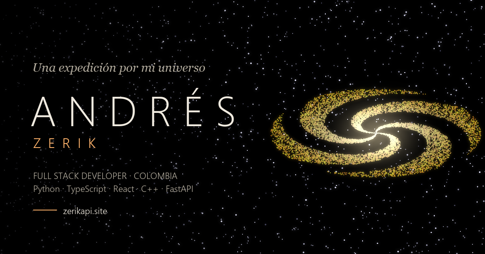

<h1 align="center">
  Zerik · Expedición
</h1>

<p align="center">
  
  
  
  
  
  
  
  
  
  
</p>

<p align="center">
  
</p>

<p align="center">
  <strong>Español</strong> | <a href="./README.md">English</a>
</p>

Mi portafolio como una expedición 3D por mi universo, publicado en <https://zerikapi.site>. Cada lenguaje de programación es una galaxia, cada framework un sistema solar dentro de ella y cada proyecto un planeta con sus librerías como lunas. Las bases de datos son agujeros negros, las herramientas forman una constelación de relaciones y los proyectos de formación flotan en un cinturón de asteroides. El viaje avanza con el scroll, está en español e inglés y termina enviando una señal desde la órbita hasta Colombia para abrir un canal en GitHub, Discord o LinkedIn.

## Stack tecnológico

| Componente | Stack | Responsabilidad |
| --- | --- | --- |
| `src/scene` | React Three Fiber, Three.js, drei, postprocessing, GLSL propio | Galaxias, sistemas solares, agujeros negros, constelación, Tierra con geografía real y recorrido de cámara |
| `src/ui` | React 19, TypeScript, Tailwind CSS 4 | HUD, paneles de enfoque, ficha de proyecto, contacto e índice accesible de proyectos |
| `src/data` | Registros tipados en TypeScript | Fuente única de lenguajes, frameworks, proyectos, herramientas y formación |
| `src/i18n` | Zustand, catálogos de mensajes tipados | Español e inglés, detección del navegador y elección recordada |
| `src/audio` | Audio HTML | Banda sonora en bucle con fundidos, reanudación y volumen recordado |
| Entrega | Vite, Bun, GitHub Actions, Cloudflare Pages, R2 | Build, despliegue continuo y CDN de la banda sonora |
| `scripts` | Python, Pillow, Playwright | Imágenes de Open Graph y de vista previa del README |

Cada proyecto se define una sola vez y se ubica según su framework principal; los proyectos que abarcan varios stacks aparecen como ecos en los otros sistemas a los que llegan. Los logos vienen de Devicon y Simple Icons, y todas las etiquetas las posiciona un único proyector que las desvanece por distancia y resuelve los choques.

Consulta la [documentación técnica](docs/README.md) para más detalles.

## Estructura del repositorio

```
ZerikPortfolio/
├── src/
│   ├── audio/                 # Reproductor de la banda sonora
│   ├── data/                  # Galaxias, sistemas, proyectos, herramientas, formación
│   ├── hooks/                 # Cuadro del viaje, fundidos, texturas
│   ├── i18n/                  # Store de idioma y mensajes ES/EN
│   ├── lib/                   # Cálculos de posición, íconos, texturas procedurales
│   ├── scene/                 # Universo en React Three Fiber
│   ├── state/                 # Stores de Zustand y estado por cuadro
│   └── ui/                    # Capas DOM
├── public/                    # Favicon, imagen Open Graph, robots y sitemap
├── scripts/                   # Generador de imágenes de vista previa (Python)
├── docs/
│   ├── en/                    # Documentación en inglés
│   └── es/                    # Documentación en español
├── .github/workflows/         # Despliegue a Cloudflare Pages en cada push a main
├── index.html                 # Metadatos, Open Graph y JSON-LD
└── vite.config.ts
```

## Requisitos

- Bun 1.4.4 o superior
- Un navegador con WebGL 2

## Primeros pasos

La [guía de primeros pasos](docs/es/getting-started.md) explica cada comando y la banda sonora en local. Inicio rápido:

1. Instala las dependencias:

   ```bash
   bun install
   ```

2. Inicia el servidor de desarrollo en <http://localhost:5173>:

   ```bash
   bun run dev
   ```

3. Genera el build de producción:

   ```bash
   bun run build
   ```

## Documentación

- [Arquitectura](docs/es/architecture.md): modelo del universo, recorrido de cámara, renderizado, etiquetas e idiomas.
- [Editar el contenido](docs/es/content.md): cómo agregar proyectos, tecnologías, sistemas, herramientas y formación.
- [Despliegue](docs/es/deployment.md): Cloudflare Pages, dominios, secretos y la CDN de la banda sonora.

## Licencia

[MIT](LICENSE) © [Zerik-Official](https://github.com/Zerik-Official)
