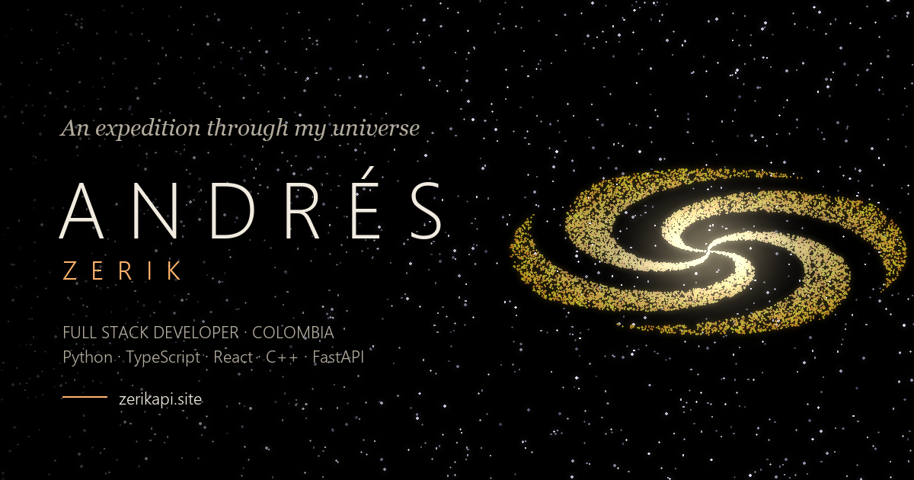

<h1 align="center">
  Zerik · Expedition
</h1>

<p align="center">
  
  
  
  
  
  
  
  
  
  
</p>

<p align="center">
  
</p>

<p align="center">
  <a href="./README.es.md">Español</a> | <strong>English</strong>
</p>

My portfolio as a 3D expedition through my universe, live at <https://zerikapi.site>. Every programming language is a galaxy, every framework a solar system inside it, every project a planet with its libraries as moons. Databases are black holes, tools form a constellation of relationships, and training projects drift in an asteroid belt. The journey is driven by scroll, available in Spanish and English, and ends by sending a signal from orbit down to Colombia to open a channel on GitHub, Discord or LinkedIn.

## Tech stack

| Component | Stack | Responsibility |
| --- | --- | --- |
| `src/scene` | React Three Fiber, Three.js, drei, postprocessing, custom GLSL | Galaxies, solar systems, black holes, constellation, Earth with real geography and camera journey |
| `src/ui` | React 19, TypeScript, Tailwind CSS 4 | HUD, focus panels, project record, contact and accessible project index |
| `src/data` | Typed TypeScript records | Single source of truth for languages, frameworks, projects, tools and training |
| `src/i18n` | Zustand, typed message catalogs | Spanish and English, browser detection and remembered choice |
| `src/audio` | HTML audio | Looping soundtrack with fades, resume and remembered volume |
| Delivery | Vite, Bun, GitHub Actions, Cloudflare Pages, R2 | Build, continuous deployment and soundtrack CDN |
| `scripts` | Python, Pillow, Playwright | Open Graph and README preview images |

Each project is defined once and placed by its main framework; projects that span stacks appear as echoes in the other systems they reach. Logos come from Devicon and Simple Icons, and all labels are positioned by a single projector that fades them by distance and resolves collisions.

See the [technical documentation](docs/README.md) for details.

## Repository structure

```
ZerikPortfolio/
├── src/
│   ├── audio/                 # Soundtrack player
│   ├── data/                  # Galaxies, systems, projects, tools, training
│   ├── hooks/                 # Journey frame, overlay fades, textures
│   ├── i18n/                  # Locale store and ES/EN messages
│   ├── lib/                   # Layout math, icons, procedural textures
│   ├── scene/                 # React Three Fiber universe
│   ├── state/                 # Zustand stores and per-frame state
│   └── ui/                    # DOM overlays
├── public/                    # Favicon, Open Graph image, robots and sitemap
├── scripts/                   # Preview image generator (Python)
├── docs/
│   ├── en/                    # English documentation
│   └── es/                    # Spanish documentation
├── .github/workflows/         # Deploy to Cloudflare Pages on push to main
├── index.html                 # Metadata, Open Graph and JSON-LD
└── vite.config.ts
```

## Requirements

- Bun 1.4.4 or newer
- A browser with WebGL 2

## Getting started

The [getting started guide](docs/en/getting-started.md) covers every command and the local soundtrack. Quick start:

1. Install the dependencies:

   ```bash
   bun install
   ```

2. Start the dev server at <http://localhost:5173>:

   ```bash
   bun run dev
   ```

3. Build for production:

   ```bash
   bun run build
   ```

## Documentation

- [Architecture](docs/en/architecture.md): universe model, camera journey, rendering, labels and i18n.
- [Editing the content](docs/en/content.md): how to add projects, technologies, systems, tools and training.
- [Deployment](docs/en/deployment.md): Cloudflare Pages, domains, secrets and the soundtrack CDN.

## License

[MIT](LICENSE) © [Zerik-Official](https://github.com/Zerik-Official)
